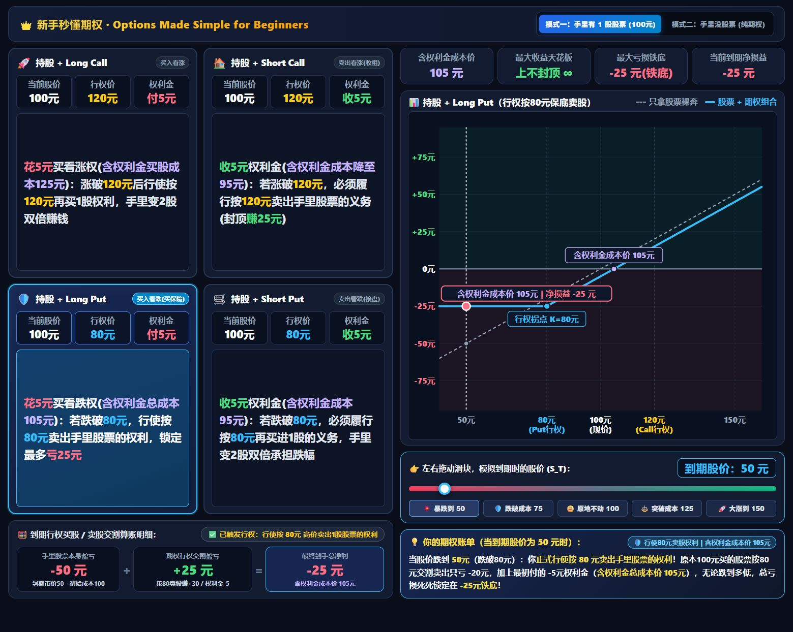

# 新手秒懂期权 · Options Made Simple for Beginners

English version: [README.md](README.md).

一个可以离线打开的中文期权教学网页。选择策略、切换是否持股，再拖动股价滑块，查看到期损益曲线、交割算账和文字解释。



## 直接使用

下载仓库 ZIP 并解压，双击 `index.html` 即可使用。不需要安装软件包、登录账户或连接券商。页面没有外部脚本、字体或行情接口依赖。

`index.html` 同时是可直接打开的完整页面和全部应用源码，HTML、CSS、JavaScript 都在里面。

## 可以学什么

- 买入看涨 Long Call、卖出看涨 Short Call、买入看跌 Long Put、卖出看跌 Short Put。
- 对比“原本持有股票”和“原本没有股票”两种情形，共八种组合。
- 调整到期股价，观察股票损益、期权损益与组合损益如何联动。
- 通过颜色区分看涨行权价、看跌行权价、支付或收取的权利金，以及含权利金的成本。

## 计算范围

当前版本是**到期损益教学模型**：初始股价100、Call行权价120、Put行权价80、初始权利金5，金额使用统一的示例单位。

页面按“每股等效单位”计算。页面中的“1股股票＋1单位期权”表示数量相互匹配，不能理解为实际账户中持有1股就能覆盖一张标准100股期权。普通美股标准股票期权通常一张对应100股；调整合约等情况需要单独查看合约规格。

当前版本没有模拟到期前的期权市场价格、时间价值、隐含波动率、保证金、手续费、税费、分红或提前指派。图表中标注的成本价，也需要结合持股模式和策略含义理解。具体例子与坐标范围见[页面说明](docs/guide.zh-CN.md)。

这是教学演示，不是实时行情或交易工具。

## 发布到 GitHub Pages

把本目录内的文件上传到公开仓库，在仓库的 **Settings → Pages** 中，选择从 `main` 分支的根目录发布。发布完成后，其他人就能通过网页链接直接使用。

完整的图形界面操作步骤见[GitHub 发布指南](docs/github-pages.zh-CN.md)。无需配置服务器、数据库或构建命令。

## 文件结构

```text
options-payoff-lab/
├── index.html                 # 可直接打开的网页，也是全部应用源码
├── README.md                  # 英文版说明（仓库首页）
├── README.zh-CN.md            # 本文件（中文版说明）
├── LICENSE                    # MIT 许可证
├── CHANGELOG.md               # 版本记录
├── CONTRIBUTING.md            # 修改与反馈说明
├── .nojekyll                  # 静态发布标记
├── .gitignore
├── .gitattributes
└── docs/
    ├── guide.md               # 英文版页面说明
    ├── guide.zh-CN.md         # 页面操作、计算与教学边界
    ├── github-pages.md        # 英文版发布指南
    ├── github-pages.zh-CN.md  # 上传仓库和发布网页的步骤
    └── preview.png            # 效果截图
```

## 修改和分享

用文本编辑器修改 `index.html`，保存后刷新浏览器即可看到结果。欢迎通过 Issue 反馈问题，或通过 Pull Request 提交改进。

项目采用 [MIT 许可证](LICENSE)，允许使用、修改和再分发；再分发时保留许可证及版权声明。
